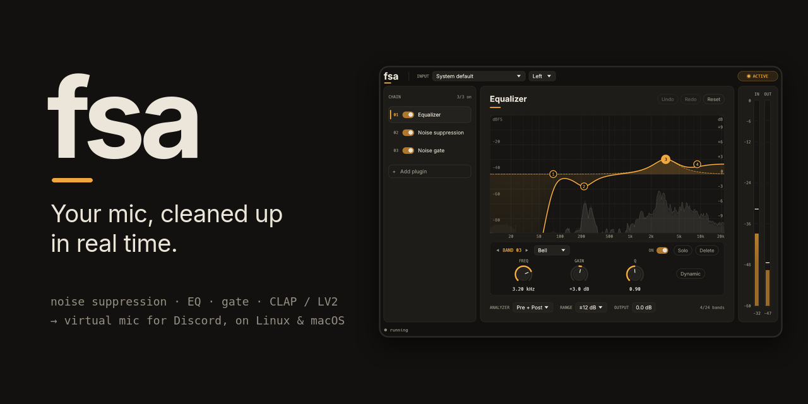

# finally simple audio



fsa cleans up your microphone in real time (noise suppression, EQ, gate,
CLAP/LV2 plugins) and exposes the result as a virtual mic that Discord, or
any other app, can use.

## Install

Linux and macOS builds are on the
[releases page](https://github.com/ehmvi/fsa/releases/latest).

### Linux (x86_64)

Requires PipeWire with its PulseAudio shim (the default on current distros)
and glibc 2.39 or newer (Ubuntu 24.04, Debian 13, Fedora 40 or later).

```sh
chmod +x fsa-x86_64.AppImage && ./fsa-x86_64.AppImage
```

In Discord, pick **Mic (processed)** as the input device.

### macOS (Apple Silicon, macOS 11+)

macOS apps can't create a virtual mic, so fsa plays into the BlackHole
virtual audio device. Install it first:

```sh
brew install --cask blackhole-2ch
```

Unzip `fsa-macos-arm64.zip` and move `fsa.app` to Applications. The app
isn't notarized, so allow the first launch in System Settings → Privacy &
Security → **Open Anyway**, or run:

```sh
xattr -dr com.apple.quarantine /Applications/fsa.app
```

In Discord, pick **BlackHole 2ch** as the input device.

### Nix

```sh
nix run github:ehmvi/fsa
```

On macOS, install BlackHole first (see
[macOS](#macos-apple-silicon-macos-11)) or use the nix-darwin module below.
On Linux distros other than NixOS, Nix-built apps often can't find your GPU
driver; use the AppImage or [nixGL](https://github.com/nix-community/nixGL)
instead.

**NixOS**: add the package and enable PipeWire with its PulseAudio shim:

```nix
# flake inputs
inputs.fsa.url = "github:ehmvi/fsa";

# configuration
environment.systemPackages = [ inputs.fsa.packages.${pkgs.stdenv.hostPlatform.system}.default ];
services.pipewire = { enable = true; pulse.enable = true; };
```

**nix-darwin**: the module installs `fsa.app` and the BlackHole driver:

```nix
inputs.fsa.url = "github:ehmvi/fsa";
# ...
modules = [
  inputs.fsa.darwinModules.default
  { programs.fsa.enable = true; }
];
```

Set `programs.fsa.blackhole.enable = false` if BlackHole is already
installed another way.

## Usage

Keep fsa running while you use the mic: the virtual mic only exists while
it's open. Turn off Discord's own noise suppression and automatic gain so
your voice isn't processed twice.

- **Input**: **Auto** (the default) switches to a mic when it's plugged in
  and back when it's unplugged. Pick a device to pin it.
- **Channel**: **Left** (default) is input 1 of an audio interface. Pick
  **Right** if your mic is on input 2, or **L+R** to mix both.
- **Output** (macOS): the BlackHole device to play into.
- **Test signal (no mic)** (macOS) in the input list plays a tone, to
  check the routing without a mic.
- Settings are saved to `~/.config/fsa/config.toml` (or under
  `$XDG_CONFIG_HOME` if set).

Command-line options (see `fsa --help`):

```
--list                      list capture sources
--input <name|auto|default> start on a source (name from --list)
--channel left|right|mix    channel of the source to use (default: left)
--config <path>             use another config file
```

## Processing

- **Noise suppression** with RNNoise, a strength control and an optional
  voice gate. Adds 20 ms of latency.
- **Equalizer** with up to 24 bands (bell, shelves, cuts, notch, band pass),
  dynamic EQ per band and a spectrum analyzer. Double-click the graph to
  add a band, drag to move it, scroll for Q, right-click for options.
- **Noise gate** with hysteresis, hold and range.
- **Plugins**: **Add plugin** lists the CLAP and LV2 effects installed in
  the standard plugin folders (and `$CLAP_PATH` / `$LV2_PATH`).
  CLAP plugins can open their own editor; LV2 plugins (x86_64 Linux only)
  get generic controls.

## Troubleshooting

Linux: if Discord doesn't list **Mic (processed)**, check that
`pactl info` shows `Server Name: PulseAudio (on PipeWire …)`. To test the
virtual mic:

```sh
pw-cli ls Node | grep -A3 fsa                # fsa.capture + fsa.processed
pw-record --target fsa.processed /tmp/t.wav  # speak, Ctrl+C, play it back
```

macOS: "no BlackHole device" means BlackHole isn't installed (see
[macOS](#macos-apple-silicon-macos-11)). The first run asks for microphone
access; if you denied it, allow fsa (or your terminal, if you started it
from one) in System Settings → Privacy & Security → Microphone. The release build is only ad-hoc signed, so macOS may ask
again after an update.

Plugin editors on Linux open as X11 windows with class `fsa-plugin`, so
tiling window managers can float them with a window rule.

## Building from source

```sh
nix develop
cargo run --release
```

Without Nix you need Rust, `pkg-config`, libclang and, on Linux, the
PipeWire, lilv and X11 headers (Debian/Ubuntu: `libpipewire-0.3-dev
liblilv-dev libx11-dev libclang-dev`).
